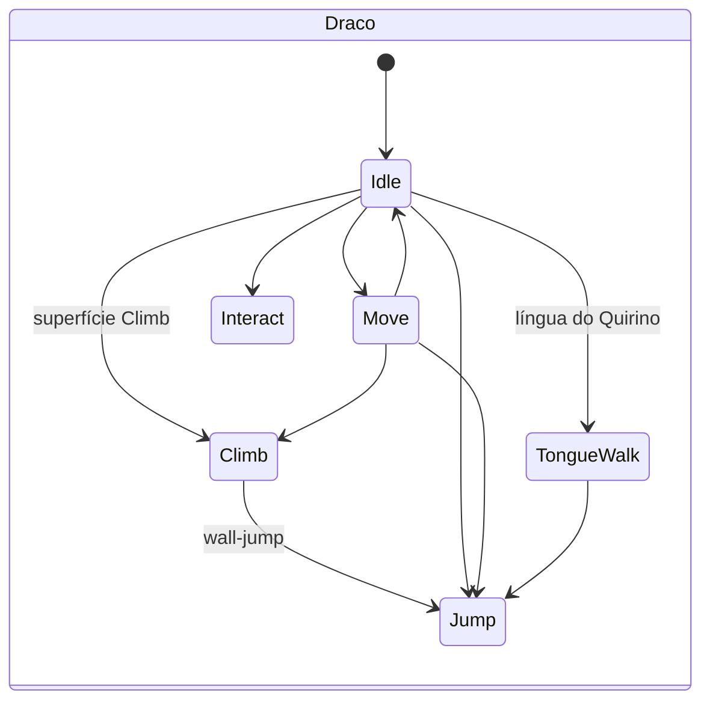
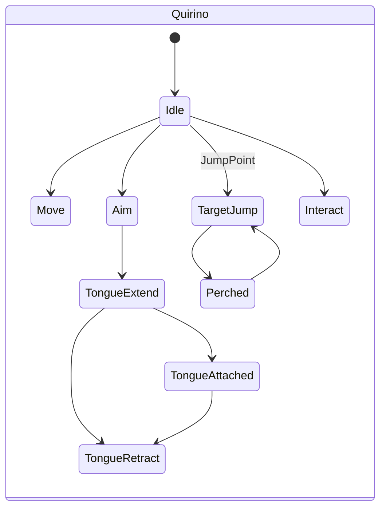

# Tale of the Lizards

Jogo 3D de plataforma e puzzle **cooperativo local para 2 jogadores**, feito em Unity 6 (URP). Cada jogador controla um lagarto com habilidades diferentes, e as fases só são resolvidas quando os dois combinam essas habilidades:

| Personagem | Habilidades |
|---|---|
| **Draco** | Anda em paredes e tetos (superfícies com a tag `Climb`), faz wall-jump, pega e carrega objetos com a boca e **anda sobre a língua do Quirino** como se fosse uma ponte |
| **Quirino** | Mira e dispara a língua (com aim assist), gruda em alvos, faz saltos guiados entre `JumpPoint`s e se empoleira neles |

A tela é dividida (split-screen), com uma câmera Cinemachine para cada jogador. O jogador 1 usa **teclado e mouse** e o jogador 2 usa **gamepad**.

---

## Stack

| | |
|---|---|
| Engine | **Unity 6000.3.9f1** |
| Render | **URP 17.3** + shaders HLSL próprios |
| Câmera | **Cinemachine 3.1** (OrbitalFollow, RotationComposer, SplineDolly, canais por jogador) |
| Input | **Input System 1.18**, com classe C# gerada e *control schemes* `KeyboardMouse` / `Gamepad` |
| Outros pacotes | Splines, ProBuilder, AI Navigation, Animation Rigging, Timeline, Post Processing |
| Ferramentas de terceiros | PlayerPrefsEditor, LFramework EditorLogger (`Assets/Plugins`) |

---

## Arquitetura

O código do time fica todo em `Assets/_Team/Scripts`:

```
_Team/Scripts
├── PlayerScripts
│   ├── ControllerPlayer
│   │   ├── StateMachinePlayers   # ControllerDraco / ControllerQuirino + estados de cada um
│   │   ├── Motor                 # DracoMotor / QuirinoMotor + Settings serializáveis
│   │   └── Interfaces            # IMovimentation, IGravity, IJump, ICheckGround, State
│   ├── AbilitysPlayer            # Língua, detector de JumpPoints, sonda de superfície, Grabber
│   └── AnimationsPlayer
├── InputScripts                  # InputReader (ScriptableObject) + IPlayerInput
├── InputBuffer                   # TimedInputBuffer<T>
├── Interactables                 # Interactable, CoopInteractionGroup, Grabbable, PinGrabbable…
├── Camera                        # FixedCameraZone, SeeThroughWall, SplineMultiTargetLookAt
├── Painting + Editor             # Ferramenta de pintura de texturas em camadas
├── Audio                         # AudioManager (IAudioService), AudioCue
├── Respawn                       # Checkpoint, KillZone, PlayerRespawn
└── UI                            # MenuManager, PauseManager, SettingsPanel, GameSettings…
```

### Máquina de estados genérica

Cada personagem tem um *Controller* (MonoBehaviour), que guarda os estados e faz as trocas, e estados em C# puro derivados de uma base genérica:

```csharp
public abstract class State<TController> : State where TController : MonoBehaviour
{
    protected readonly TController Controller;
}
```





- O `Controller` expõe `LocomotionState`, uma propriedade calculada (Idle, Move ou Climb) que os estados usam para voltar ao estado "neutro" sem precisar conhecer os outros.
- Física fica no `FixedUpdate` do estado e leitura de input/animação no `Update`.
- A física do personagem fica isolada em **Motors** (`DracoMotor`, `QuirinoMotor`), classes puras que recebem `Rigidbody`, `Transform`, câmera e um objeto `Settings` serializável. Os estados só chamam `Motor.MoveOnGround`, `Motor.Jump`, `Motor.CutJump` e afins.
- Movimento, gravidade, pulo e checagem de chão são **componentes por interface** (`IMovimentation`, `IGravity`, `IJump`, `ICheckGround`), instanciados por composição.

### Andar em paredes (Draco)

Fica em `DracoMotor`, `WallAndGroundSurfaceProbe` e `SurfaceNormalTracker`:

1. **Sondagem:** a cada `FixedUpdate`, dois `SphereCast`s saem do centro do `CapsuleCollider`, um para a frente (parede) e outro para baixo (chão), ignorando a layer `Players`.
2. **Rastreamento da normal:** se algum hit tiver a tag `Climb`, a normal vira a "gravidade" atual. Um *grace time* mantém a última normal por alguns frames, para o personagem não se soltar em quinas e arestas.
3. **Gravidade falsa:** com a gravidade do Rigidbody desligada, uma velocidade acumulada empurra o lagarto contra a superfície (`m_surfaceFallSpeed`), zerada quando ele está colado o suficiente (`GravityOffDistance`).
4. **Orientação:** o *up* é interpolado até a normal com `Slerp` independente de framerate (`1 - exp(-k·dt)`), e a rotação é aplicada **em torno do centro do collider** (`MoveRotation` + `MovePosition` compensando o pivô), o que evita que a cápsula "pule" ao trocar de plano.
5. **Wall-jump:** pula na direção `normalize(normal + up)` e ativa um `detachTimer` para não grudar de novo na mesma parede.

### Língua do Quirino como ponte (mecânica cooperativa)

- `QuirinoTongue` dispara a partir de um ponto de mira calculado pela câmera. Se o raycast exato não acerta um `ITongueTarget`, um **aim assist** com `SphereCastNonAlloc` (buffer pré-alocado, sem alocação de GC) procura o alvo mais provável e confirma a linha de visão.
- A língua implementa `ITongueBridge` (`BridgeStart`, `BridgeEnd`, `IsWalkable`). O Draco só depende dessa interface.
- No `TongueWalkStateDraco`, a posição do Draco vira um **escalar ao longo do segmento** da língua. O input relativo à câmera é projetado na direção da ponte, a distância é limitada com margem nas pontas e o Rigidbody segue o ponto alvo por velocidade (`(alvo − pos) / fixedDeltaTime`), o que mantém as colisões funcionando.

### Salto guiado (Quirino)

`JumpPointDetector` usa `OverlapSphereNonAlloc` para achar o melhor `JumpPoint` na direção do input. O `TargetJumpStateQuirino` faz um arco parabólico analítico, `lerp(start, end, t) + up · 4h·t(1−t)`, com duração proporcional à distância horizontal, e termina no estado `Perched`.

### Input: dois jogadores na mesma máquina

- `InputReader` é um **ScriptableObject** que implementa `IPlayerInput` e o callback da classe gerada pelo Input System. Ele expõe eventos C# (`JumpStarted`, `Interact`, `Aim`, `FireTongue`…).
- Existe um asset por jogador (`InputReader_Player1` → `KeyboardMouse`, `InputReader_Player2` → `Gamepad` com índice). O reader aplica `bindingMask` por grupo e atribui `devices` à instância de controles, isolando os dispositivos de cada jogador sem usar `PlayerInputManager`. Também repareia os dispositivos quando um controle é conectado ou desconectado.
- `TimedInputBuffer<T>` guarda um input por uma janela configurável (padrão de 0,25 s) para jump buffering e interações. Eventos de pulo são "latched" no `Update` e consumidos no `FixedUpdate`, para nenhum input se perder entre os dois loops.
- `GamepadDetector` avisa no menu quando não há gamepad conectado, já que o co-op exige teclado/mouse **e** gamepad.

### Interações e puzzles cooperativos

- `Interactable` / `PlayerInteractor`: cada personagem tem seu interactor, com filtro por personagem (`InteractorCharacter` é um enum de flags `Draco | Quirino`).
- `CoopInteractionGroup`: só dispara `UnityEvent`s quando **todos** os `CoopInteractable` do grupo estão em uso ao mesmo tempo. Pode ser *one-shot* e soltar os personagens automaticamente.
- `Grabbable` / `DracoGrabber`: pegar e soltar objetos, que herdam a velocidade do Draco.
- `InteractionIndicator`: indicador em world-space com shader próprio, usando um `MaterialPropertyBlock` estático compartilhado e textura padrão gerada em runtime.

### Câmeras

- **Split-screen com Cinemachine 3:** cada jogador tem seu `CinemachineBrain` em um canal próprio.
- `FixedCameraZone`: ao entrar no trigger, cria uma **cópia da câmera fixa no canal daquele jogador**, com contagem de colliders sobrepostos por Rigidbody para lidar com personagens que têm vários colliders. O blend usa o Default Blend do Brain.
- `SeeThroughWall`: faz um `SphereCastAll` da câmera até o personagem e, se houver oclusão, publica a posição e os parâmetros via `Shader.SetGlobalVector` para o shader `SeeThroughLit` recortar a parede em volta do jogador.
- `SplineMultiTargetLookAt`: em câmeras de dolly em spline (cutscenes e travellings), interpola o *LookAt* entre vários pontos de interesse conforme o progresso normalizado na spline.

### Rendering e shaders próprios (`Assets/_Team/Shaders`)

| Shader | Uso |
|---|---|
| `LayeredPaint.shader` / `.hlsl` | Material com 4 camadas de textura misturadas por uma máscara pintada |
| `SeeThroughLit.shader` / `SeeThroughWall.hlsl` | Lit URP com recorte esférico suave em torno do jogador ocluído |
| `VolumetricBeam.shader` | Feixes de luz volumétricos falsos |
| `InteractionIndicator.shader` | Ícones de interação |

### Ferramenta de editor: pintura de texturas em camadas

Em `Tools > Tale of the Lizards > Pintura de Texturas` (`LayeredPaintWindow`, cerca de 1.100 linhas):

- Pinta as 4 camadas do `LayeredPaint` diretamente em malhas **ProBuilder** na Scene View.
- Gera UV2 automaticamente e guarda a máscara como PNG por objeto.
- O pincel é uma **esfera no espaço do mundo**: cada texel conhece sua posição 3D, então a pintura atravessa faces sem emendas. Um grid espacial acelera a busca dos texels dentro do pincel.
- Tem Undo/Redo integrado ao Unity (`LayeredPaintUndoState`) e salva junto com a cena.
- Em runtime, `LayeredPaintSurface` entrega a máscara por `MaterialPropertyBlock`, então vários objetos podem **compartilhar o mesmo material** e ainda assim ter pinturas diferentes.

### Áudio, UI e persistência

- `AudioManager` (implementa `IAudioService`): crossfade de música com duas `AudioSource`s, **pool de SFX** pré-alocado, roteamento por `AudioMixerGroup` (Master/Music/SFX) e volume pelos parâmetros expostos do mixer.
- `GameSettings` (ScriptableObject): sensibilidade de mouse e gamepad e volumes, persistidos em `PlayerPrefs` e aplicados ao vivo pelo menu de pausa.
- `MenuManager`, `PauseManager`, `SettingsPanel`, `ScreenFader`: UI navegável por gamepad (seleção adiada um frame para o uGUI) e transições com fade.
- `Checkpoint`, `KillZone`, `PlayerRespawn`: respawn por jogador com eventos `Died` e `Respawned`, que os controllers usam para resetar estado, soltar objetos e limpar buffers.
- `UrpProjectSetup` (editor): aplica o URP Asset em todos os níveis de qualidade do projeto.

---

## Cenas

| Cena | Caminho |
|---|---|
| Menu principal | `Assets/_Team/Scenes/Menu.unity` |
| Cutscene de abertura | `Assets/_Team/Scenes/Levels/CutsceneLivro.unity` |
| Floresta | `Assets/_Team/Scenes/Levels/Floresta.unity` |
| Veterinário | `Assets/_Team/Scenes/Levels/VeterinarianLevel.unity` |
| Sandbox de mecânicas | `Assets/_Team/Scenes/DevelopMachanics/SimplesMechanics.unity` |

## Como rodar

1. Clone o repositório. A branch principal de desenvolvimento é `Develop`.
2. Abra no **Unity Hub** com a versão **6000.3.9f1**.
3. Abra `Assets/_Team/Scenes/Menu.unity` e dê Play.
4. Conecte **um gamepad** para o jogador 2. O jogador 1 usa **teclado e mouse**.

### Controles

| Ação | Teclado / mouse | Gamepad |
|---|---|---|
| Mover | WASD | Analógico esquerdo |
| Câmera | Mouse | Analógico direito |
| Pular | Espaço | A / ✕ (botão sul) |
| Interagir | E | B / ◯ (botão leste) |
| Mirar | Botão direito | LT / L2 |
| Disparar língua | Botão esquerdo | RT / R2 |
| Travar/destravar cursor | Esc | — |

> Bindings em `Assets/InputsActions/PlayersControlls.inputactions`.

## Convenções de código

- Campos privados com prefixo `m_`, estáticos com `s_`, constantes com `k_`, variáveis locais com `_`.
- Dependências entre sistemas feitas por interfaces (`IPlayerInput`, `ITongueBridge`, `ITongueTarget`, `IAudioService`).
- Buffers de física pré-alocados (`*NonAlloc`) nos sistemas que rodam todo frame.
- Gizmos de debug para as sondas de superfície, ranges e casts (`OnDrawGizmosSelected`).
